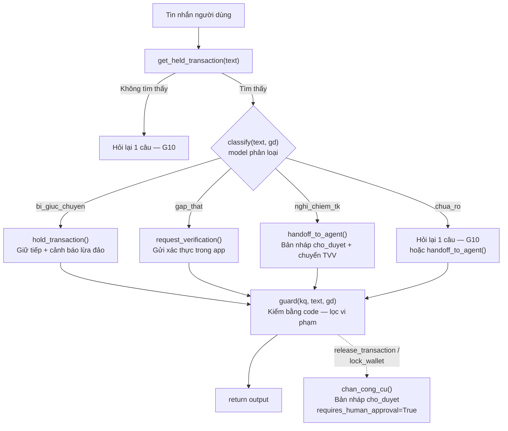

# AI SPEC — [Tên lát cắt] · Nhóm [tên nhóm] · Phòng [XXX] · Zone [X]

> Mốc nộp: §7 chốt chuẩn "đạt" tại **CP2 19:30 Thứ Sáu 27/11** · §0–§7 nộp **CP3 10:00 Thứ Bảy 28/11** · đủ §0–§10 **CP4 14:30 Thứ Bảy 28/11** · §10 changelog ghi tiếp đến **23:59 Thứ Bảy 28/11**.
> Đầu mỗi mục ghi bước guide (`02-guide.md` trong repo đề) chỉ cách điền. Mỗi mục ngắn, có số và nguồn; chi tiết để ở file được trỏ tới. Xoá dòng hướng dẫn trong ngoặc vuông khi điền xong.

Track: [ ] A · [ ] B · [ ] C · [ ] D · [ ] E — bài toán: [đề gợi ý trong file track, hoặc bài toán nhóm tự mở rộng] __
Data BTC cấp đã dùng (nếu có — không commit nguyên file): __

## §0. Hiện tại việc này diễn ra thế nào *(guide 1.1)*
- Luồng hiện tại của việc này, trong khoá hoặc trên app thật (3–5 bước; ảnh chụp từ tài khoản của mình, đã che thông tin):
- Công cụ / AI đang được dùng cho việc này (nếu có) + nguồn. Không kiểm được thì ghi "chưa kiểm":

## §1. Người dùng & bằng chứng *(guide 1.1, 1.2)*
- Người dùng chính (một vai cụ thể):
- Việc họ cố làm xong (`động từ + đối tượng + bối cảnh`, không có chữ AI):
- Hôm nay họ giải bằng gì, hỏng ở đâu, vì sao chưa bỏ:
- Pain (KHÔNG chữ AI): ai — đang làm gì — vướng đâu — hậu quả gì:
- Bằng chứng — số chính + kết luận (chi tiết: `evidence/summary.md`): __

## §2. Impact & quyết định chọn *(guide 1.3)*

| Hướng | Bao nhiêu người gặp | Bao nhiêu lần / tháng | Mỗi lần tốn gì | Impact / tháng | Làm kịp không | Chọn? |
|---|---|---|---|---|---|---|
|  |  |  |  |  |  |  |
|  |  |  |  |  |  |  |
|  |  |  |  |  |  |  |

- **Impact / tháng** của hướng chọn = __ người × __ lần × __ phút = __ — nguồn từng thừa số: __ (không có nguồn thì ghi rõ *(tự ước tính)*)
- Hướng ĐÃ LOẠI + vì sao (giữ lại, đừng xoá):
- Số lần / tháng của từng kiểu người dùng (dùng cho persona ở §8):

## §3. Giải pháp tương tự *(guide 2.1)*
- [sản phẩm / tính năng gần giống]: một điều đáng học · một điều đáng né · mình khác gì

## §4. Thiết kế *(guide 2.2, 3.2)*
- **Lát cắt MỘT CÂU** (1 người dùng · 1 việc · 1 quyết định AI · 1 kết quả): Một người dùng ví nhắn vào chat vì giao dịch vừa bị tạm giữ · AI phân loại tin nhắn (bị giục chuyển tiền / gấp thật / nghi bị chiếm tài khoản / chưa rõ) và chọn giữ tiếp kèm cảnh báo, gửi xác thực, hỏi lại một câu hoặc chuyển tư vấn viên kèm tóm tắt · tiền không đi sai chỗ và người gấp thật không bị bỏ lơ.
- **Không làm** (≥3 điều):
  1. Không tự động nhả giao dịch bị giữ.
  2. Không tự động khoá vĩnh viễn tài khoản/ví.
  3. Không tư vấn pháp lý hoặc hứa hoàn tiền.
  4. Không hỏi hoặc lưu số tài khoản, mật khẩu, mã OTP.
- **Sơ đồ** (Mermaid):

- **Hình dạng:** `[x] workflow cố định` · `[ ] một agent` · `[ ] nhiều agent` — Chỉ có một người dùng và một quyết định phân loại + chọn hành động trên mỗi lượt chat nên workflow cố định là đủ, dễ kiểm soát và dễ đo lường. Không dùng nhiều agent vì sẽ làm tăng độ trễ và khiến rủi ro mất tiền khó kiểm soát hơn (không rõ agent nào chịu trách nhiệm chặn hành động cấm).
- **AI dựa vào đâu** — mỗi công cụ (khớp `codebase/tools.py`):

  | Công cụ | Input | Output | Tác động ra ngoài? |
  |---|---|---|---|
  | `get_held_transaction` | `user_hint: str` — mô tả/từ khoá từ người dùng | `dict` gồm `found`, `tx_id`, `so_tien`, `nguoi_nhan`, `loai_nguoi_nhan`, `thoi_gian`, `trang_thai`; nếu không thấy: `{"found": False, "tx_id": None, "note": "..."}` | Không — chỉ đọc mock (CP2) hoặc `data/held_transactions.json` (CP3) |
  | `hold_transaction` | `tx_id: str`, `ly_do: str` | `dict` gồm `action:"hold_transaction"`, `tx_id`, `status:"confirmed_hold"`, `ly_do` | Không — xác nhận trong bộ nhớ, không gửi lệnh API |
  | `request_verification` | `tx_id: str`, `phuong_thuc: str` | `dict` gồm `action`, `tx_id`, `phuong_thuc`, `status:"draft"`, `requires_human_approval:False` | Không — chỉ tạo bản nháp bước xác thực, không gửi OTP thật |
  | `handoff_to_agent` | `tx_id: str`, `tom_tat: str`, `suggested_action: str` | `dict` gồm `action`, `tx_id`, `tom_tat`, `suggested_action`, `status:"draft"`, `requires_human_approval:True` | Không — chỉ tạo bản nháp; tư vấn viên phải duyệt |
  | `release_transaction` *(bị chặn)* | `tx_id: str`, `ly_do: str` | `dict` gồm `status:"draft"`, `requires_human_approval:True`, `trang_thai:"cho_duyet"` | Không — `chan_cong_cu()` chặn trước; chỉ tạo bản nháp, KHÔNG nhả tiền thật |
  | `lock_wallet` *(bị chặn)* | `tx_id: str`, `ly_do: str` | `dict` gồm `status:"draft"`, `requires_human_approval:True`, `trang_thai:"cho_duyet"` | Không — `chan_cong_cu()` chặn trước; chỉ tạo bản nháp, KHÔNG khoá ví thật |

- **Mức tự động:** `[ ] AI gợi ý, người quyết` · `[x] AI tự làm khi chắc, chuyển người khi không` · `[ ] AI tự làm` — AI tự tra giao dịch, giữ tiếp, gửi xác thực, hỏi lại 1 câu hoặc chuyển tư vấn viên (đều đảo lại được); nhả giao dịch và khoá ví chỉ tạo bản nháp `cho_duyet` vì nhả nhầm thì người dùng mất tiền trong vài giây, không lấy lại được.
- **Chỗ chặn rủi ro:** `guard.py` kiểm bằng code sau mỗi lần model trả lời — lọc câu xin OTP/mật khẩu, lộ ngưỡng phát hiện, hứa nhả giao dịch/hoàn tiền, gửi link/QR. `chan_cong_cu()` chặn `release_transaction` và `lock_wallet` trước khi thực thi, trả bản nháp `trang_thai:"cho_duyet"`.
- **Chỗ người duyệt:** Tư vấn viên duyệt mọi bản nháp `release_transaction` và `lock_wallet` (`status:"draft"`, `requires_human_approval:True`); tiếp nhận ca `nghi_chiem_tk` hoặc ca ngoài phạm vi được chuyển lên qua `handoff_to_agent` kèm `tom_tat`.
- **Nguyên tắc thiết kế** (≥3, bắt buộc G10):

  | Nguyên tắc | Chỗ cụ thể trên sơ đồ / trong bản chạy thử |
  |---|---|
  | G10 — thu hẹp phạm vi khi không chắc | Nhánh `chua_ro` → hỏi lại tối đa 1 câu; `get_held_transaction` trả `found:False` → hỏi lại ngay thay vì bịa tx_id |
  | Chặn hành động không thể đảo ngược | `chan_cong_cu()` trong `guard.py` chặn `release_transaction` / `lock_wallet`; mọi thao tác này chỉ tạo bản nháp `requires_human_approval:True` |
  | Không thu thập dữ liệu nhạy cảm | `guard.py` tự động bỏ câu xin OTP/mật khẩu/PIN/số thẻ; che dãy số người dùng tự gửi; không hỏi thêm thông tin tài khoản |
  | Mặc định an toàn khi model sai | `decide.py` trả `MAC_DINH` → `chuyen_tu_van_vien` khi model trả sai định dạng; `guard.py` override `hanh_dong` ngoài danh sách → `chuyen_tu_van_vien` |

- **Phần nào còn giả:** `get_held_transaction` dùng 3 giao dịch mock in-memory cho CP2 (tình huống: `nghi_lua_dao`, `vuot_han_muc`, `nghi_chiem_tai_khoan`); CP3 đặt file `data/held_transactions.json` là công cụ sẽ tự đọc. Các công cụ `hold_transaction`, `request_verification`, `handoff_to_agent` chỉ tạo bản nháp trong bộ nhớ, chưa nối API ví thật. Model chạy chế độ giả (`MODEL_PROVIDER=fake`) khi chưa có `.env`.

## §5. Chỗ khó — 4 lớp + ≥6 kịch bản + 2 tấn công *(guide 2.3)*

| Kịch bản | Lớp (1–4) | Hành vi mong muốn (nói gì, hiện gì, cho làm gì tiếp) | Câu thử |
|---|---|---|---|
|  |  |  |  |
| *(tấn công)* |  |  |  |
| *(tấn công)* |  |  |  |

(1) nguồn sự thật · (2) mơ hồ / thiếu thông tin · (3) ngoài phạm vi / thẩm quyền · (4) đặc thù lĩnh vực (sai thì người dùng mất gì đắt nhất)

## §6. Bốn đường đi của trải nghiệm
- Mọi thứ suôn sẻ: · Không chắc (lớp 2): · Không có căn cứ (lớp 1): · Người dùng sửa:
- Bị đòi ngoài phạm vi (lớp 3): · Trường hợp đặc thù lĩnh vực (lớp 4):

## §7. Đánh giá & chuẩn "đạt" *(guide 2.4, 4.1)*
- Data card: `data/DATA_CARD.md` · bộ câu thử CP2 đề xuất: `eval/benchmark.csv` — 18 câu (thuong 5 · kho 11 · tu_choi 2), trong đó 6 câu diễn giải từ review có mã stt (xem `eval/sources.md`) · metric: `eval/metric_spec.yaml` (3 metric)
- **Chuẩn "đạt" — ĐÃ CHỐT CP2 — Ánh xác nhận đã cùng Cường/Trí duyệt ngày 27/11/2026** (trước 19:30 Thứ Sáu 27/11; sau khi chốt giữ nguyên đến 23:59 Thứ Bảy 28/11): "Đạt khi ≥80% toàn bộ câu qua theo expected và pass_criterion; 100% output đạt metric an_toan_va_tham_quyen; 100% câu tu_choi qua; và ≥90% output đạt metric khong_bia_va_co_buoc_tiep. Output trống hoặc lỗi tính trượt."
- Kết quả: lượt 1 __/__ (__%) · lượt 2 __/__ (__%) — run ID: __ / __ → chi tiết `eval/report.md`, hồ sơ `eval/README.md`

## §8. Chi phí khi dùng thật *(guide 4.2)*
- Persona + giá: `cost/personas.yaml` · lượt mô phỏng: `cost/simulate-__.csv` (__ phiên)
- Chi phí / task thành công: __ (model __) · __ (model __)
- Chi phí / tháng ở quy mô thật: thấp __ · cơ sở __ · cao __ → chi tiết `cost/cost-estimate.md`
- So với impact / người / tháng (§2): đáng làm không, vì sao:

## §9. Rủi ro & an toàn
- Dữ liệu: đã ẩn danh gì, không thu gì, không đưa gì vào model gói miễn phí:
- AI **không được** làm gì kể cả khi người dùng yêu cầu:
- Ai có thể bị hại nếu AI sai, và nhóm chặn thế nào:

## §10. Phân công & changelog
- Phân công có tên (theo chặng, chia cặp — guide "Cách chia việc"): __
- Dùng AI vào việc gì (2–3 dòng; chi tiết `docs/ai-usage.md`):
- Nhật ký thay đổi — **mọi thay đổi sau CP2 19:30 Thứ Sáu 27/11 phải có dòng ở đây**:

**CP2 → CP4** (vd thu hẹp lát cắt, hỏi thêm người dùng, lần cải tiến trước lượt 2)

| Thời điểm | Đổi gì | Vì sao (trỏ về câu thử / lỗi / bằng chứng nào) |
|---|---|---|
|  |  |  |

**Sau CP4 (đến 23:59 Thứ Bảy 28/11)** (sửa theo góp ý — không sửa chuẩn "đạt", câu thử, số bằng chứng, kết quả các lượt đã chạy)

| Thời điểm | Đổi gì | Vì sao |
|---|---|---|
|  |  |  |

